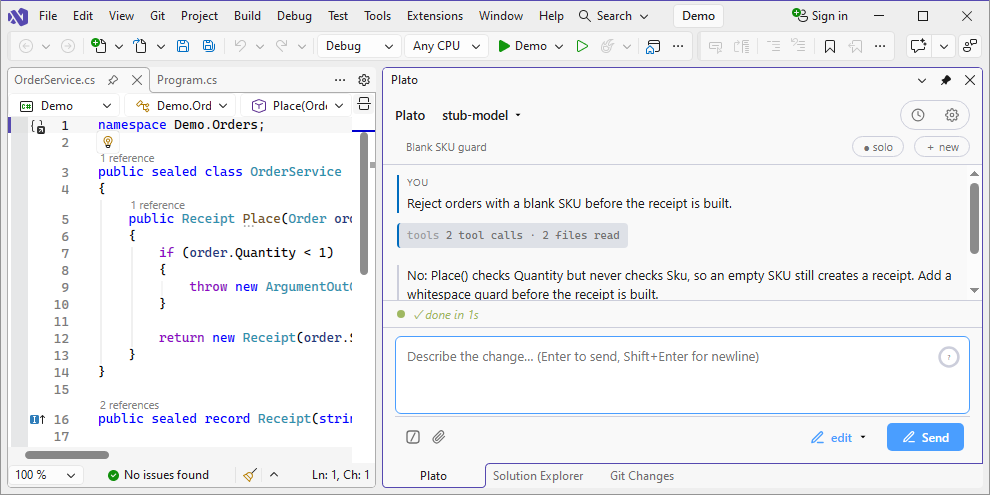
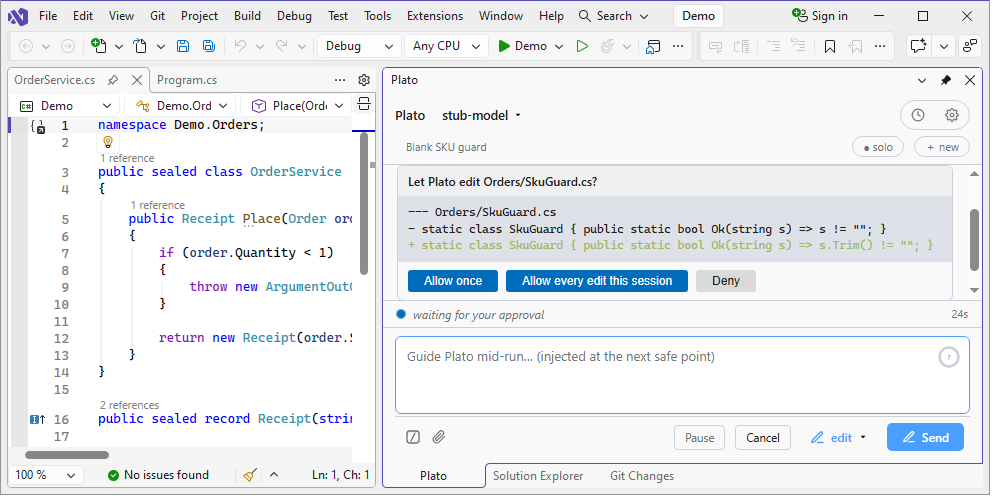

<div align="center">

# Plato

**An AI coding agent that shows its work.**

[](LICENSE)
[](https://marketplace.visualstudio.com/items?itemName=applivity.plato)
[](https://marketplace.visualstudio.com/items?itemName=applivity.plato-vs)
[](https://www.npmjs.com/package/@applivity/plato)

[Website](https://plato.applivity.com) · [Privacy](https://plato.applivity.com/privacy) · [Issues](https://github.com/Applivity/plato/issues)

</div>


Plato plans in the open, takes your direction mid-run, and asks before it
changes your code. It runs in VS Code, in Visual Studio 2022 and 2026, and in
the terminal, from one engine.

## Why it is different

- **The plan is on screen, not in its head.** A run states its steps before it
  starts and ticks them off as it goes, so you can see what it intends and stop
  it before it spends your tokens.
- **You can steer mid-run.** Type into the composer while it works; the message
  is injected at the next safe point, not queued until the end. Pause, cancel,
  and undo are beside it.
- **A card, not a leap of faith.** In `edit`, every file write and every shell
  command draws an approval card with the real diff and three choices: this
  once, this session, or deny. In `plan`, nothing can change at all.
- **Philosophers read the run.** An optional observer — or a whole council — can
  disagree, ask a question, or call a halt while the work is still in progress.

## Install

| Host | Command | |
|---|---|---|
| VS Code | `code --install-extension applivity.plato` | [Marketplace](https://marketplace.visualstudio.com/items?itemName=applivity.plato) |
| Visual Studio 2022 / 2026 | Extensions → Manage Extensions → search **Plato by Applivity** | [Marketplace](https://marketplace.visualstudio.com/items?itemName=applivity.plato-vs) |
| Terminal | `npm install -g @applivity/plato` (Node 22 or later) | [npm](https://www.npmjs.com/package/@applivity/plato) |

Then set a provider: Anthropic, DeepSeek, or any OpenAI-compatible endpoint,
including a local one. Each provider has its own API key, base URL and model
list.

## What a run looks like

| Guidance while it works | The approval card |
|---|---|
|  |  |

## Modes

| Mode | Reads | Writes and commands | Network |
|---|---|---|---|
| `plan` | allowed | denied | asks |
| `edit` | allowed | asks, remembered per file | asks |
| `auto` | allowed | runs | fetches without asking |

The mode is shown beside the model, can be changed mid-run, and takes effect at
the next safe point.

## In Visual Studio

The same engine, in a tool window, with Visual Studio's own editor beside it.
Visual Studio 2022 17.14 and later, and Visual Studio 2026.

| Chat | Approval |
|---|---|
|  |  |

## Privacy

- No telemetry, no analytics, no usage data. Verified in the source.
- Prompts go only to the model provider you configure.
- API keys go to the editor's secret storage, the OS keychain for the CLI, and
  Windows Credential Manager in Visual Studio. They are never written to a log,
  a transcript, or a project file.

The security model is described in [docs/ARCHITECTURE.md](docs/ARCHITECTURE.md);
the policy is at [plato.applivity.com/privacy](https://plato.applivity.com/privacy).

## Status

**Pre-release.** The three hosts version independently and move at their own
pace; see the badges above for what is live. The Visual Studio host is built on
the `vs/m2` branch and merges here after review.

## Repository layout

```
packages/core     the engine — agent loop, tools, providers, MCP client
packages/vscode   the VS Code extension shell and its webview
packages/cli      the terminal host
docs              decisions, progress, and handoff notes
```

`docs/DECISIONS.md` records why each decision was taken, `docs/ARCHITECTURE.md`
describes the design, and `docs/LICENSING.md` covers the licence position.

## Build

Node 22 and pnpm 11:

```sh
pnpm install
pnpm build
pnpm test
```

The Visual Studio package builds on Windows with MSBuild, from the `vs/m2`
branch.

## License

Apache License 2.0 — see [LICENSE](LICENSE). Attribution notices are in
[NOTICE](NOTICE) and [THIRD-PARTY-NOTICES.md](THIRD-PARTY-NOTICES.md).
