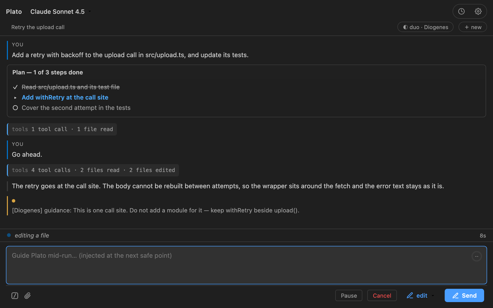
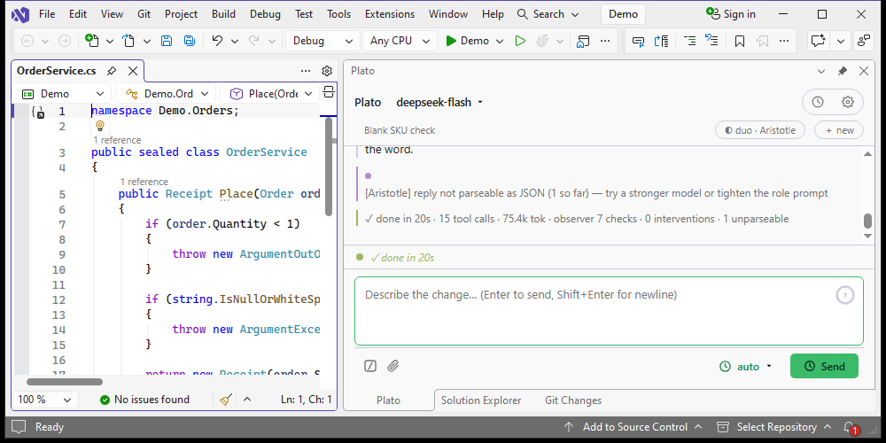
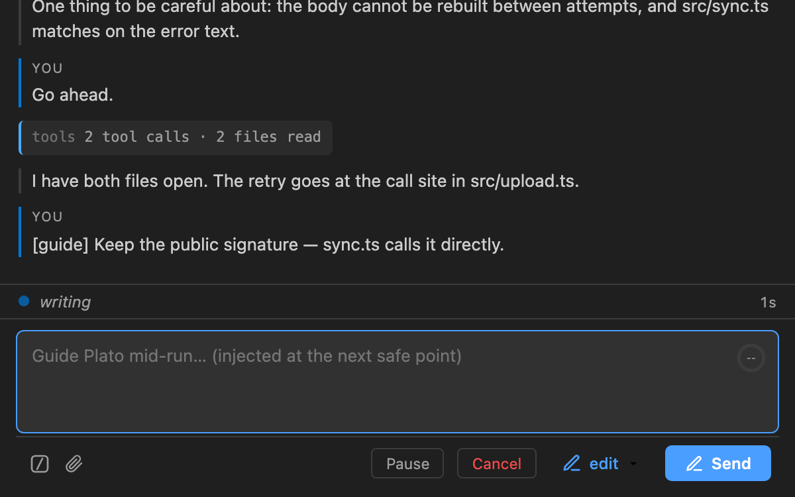
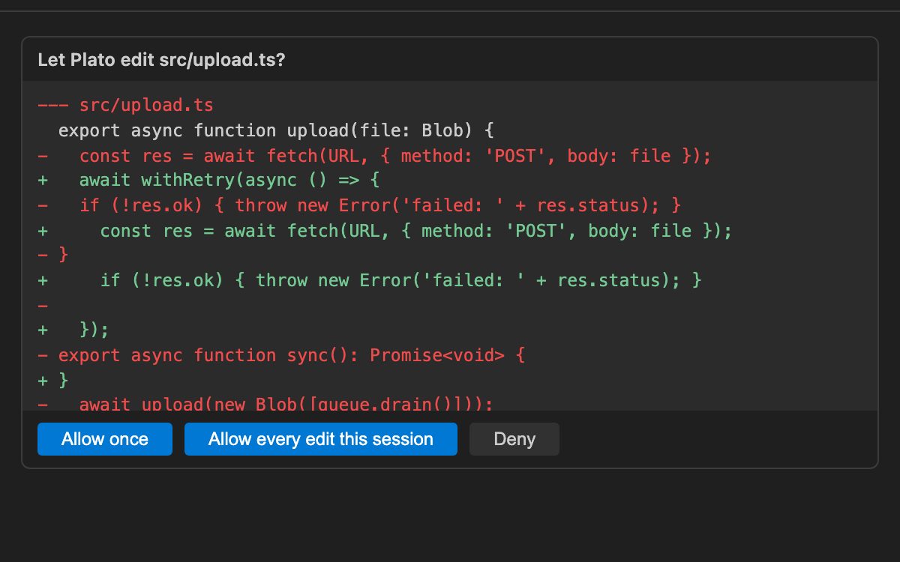

<div align="center">

# Plato

**Plato does the work. Philosophers keep it honest.**

[](LICENSE)
[](https://marketplace.visualstudio.com/items?itemName=applivity.plato)
[](https://marketplace.visualstudio.com/items?itemName=applivity.plato-vs)
[](https://www.npmjs.com/package/@applivity/plato)

[Website](https://plato.applivity.com) · [Privacy](https://plato.applivity.com/privacy) · [Issues](https://github.com/Applivity/plato/issues)

</div>



Plato is an AI coding agent for VS Code, Visual Studio and the terminal. It
plans in the open, takes your direction mid-run, and asks before it changes your
code.

Most agents work alone and tell you what happened afterwards. Plato brings
company: a second reader going over the work while it is happening, named for
what it looks for. It can interrupt, pause, or stop the run.

## Who is in the room

Plato is always the one doing the work. What changes is who is watching, and how
much they are allowed to do about what they see.

- **Solo** — Plato works alone. Nothing else is looking over its shoulder.
  Fastest, and the cheapest to run.
- **Duo** — one philosopher reads along, with its own temperament, its own
  permissions, and a model you can point anywhere. It can speak up, pause the
  run, or stop it.
- **Academy** — two to five philosophers, each given a different thing to watch
  for. A council instead of a single opinion.



## The five you can put in the room

Each is a full model in its own right, with a temperament written for what it is
good at. Point one at another provider and it stops being the same model
checking its own homework — it can catch what the working model is blind to.

| Philosopher | Watches for |
|---|---|
| **Aristotle** | Evidence. Flags claims made without verification, and changes never re-checked after they were applied. |
| **Heraclitus** | Change. Risky edits and regressions introduced mid-run; speaks up early when the direction turns. |
| **Diogenes** | Bloat. Calls out overcomplication and gold-plating in one line, and prefers the simple answer. |
| **Pythagoras** | Structure and correctness: types, counts, invariants, repeated patterns. Intervenes when the numbers do not add up. |
| **Thales** | A light first pass. Flags only clear, obvious mistakes, and stays quiet when uncertain. |

A watcher has four things it can do — leave the work alone, send one short
correction, pause the run and hand it back to you, or stop it. Permissions are
set per watcher, so you can allow a pause and refuse a stop. A watcher that
errors or answers with nonsense is counted and ignored; it can never hang the
run. Each has a budget of five interventions by default, and the count is shown
when the run ends.

## Watch the work. Then change it.

Every tool call is written into the conversation as it runs: the file it reads,
the search it makes, the write it proposes. The composer stays live while the
work continues, and what you type reaches Plato inside the same task, at the
next safe point.

`Pause` stops at the next safe point and hands control back. `Cancel` stops the
task and keeps the transcript. `/queue` holds a message for the next task,
because during a run the composer means "change this run".

## Three modes

| Mode | Reads | Writes and commands | Web requests |
|---|---|---|---|
| `plan` | allowed | denied | asks |
| `edit` | allowed | asks; a file approved once is not asked about again this session | asks |
| `auto` | allowed | runs without asking | fetches without asking |

In `edit`, a write or a command raises an approval card with the real diff and
three choices: allow once, allow for this session, deny. In `plan`, writes and
commands are refused outright — nothing on disk can change. In `auto` no
card stands between a fetched page and the model — the three limits that still
hold are enforced in the request itself: a redirect onto a loopback or private
address is refused, a non-text response is refused, and fetched content arrives
labelled untrusted.

The mode is read live at every tool call, so changing it mid-run takes effect on
Plato's next action, and the run record names the mode it began in.

| Guidance while it works | The approval card |
|---|---|
|  |  |

## In Visual Studio

The same engine in a tool window, with Visual Studio's own editor beside it.
Visual Studio 2022 17.14 and later, and Visual Studio 2026.

| Chat | Approval |
|---|---|
|  |  |

## Install

| Host | Command | |
|---|---|---|
| VS Code | `code --install-extension applivity.plato` | [Marketplace](https://marketplace.visualstudio.com/items?itemName=applivity.plato) |
| Visual Studio 2022 / 2026 | Extensions → Manage Extensions → search **Plato by Applivity** | [Marketplace](https://marketplace.visualstudio.com/items?itemName=applivity.plato-vs) |
| Terminal | `npm install -g @applivity/plato` (Node 22 or later) | [npm](https://www.npmjs.com/package/@applivity/plato) |

Then set a provider: Anthropic, DeepSeek, or any OpenAI-compatible endpoint,
including a local one. Each connection has its own API key, base URL and model
list.

## Privacy

- No telemetry, no analytics, no usage data. Verified in the source.
- Prompts go only to the model provider you configure.
- API keys go to the editor's secret storage, the OS keychain for the CLI, and
  Windows Credential Manager in Visual Studio. They are never written to a log, a
  transcript, or a project file.
- Protected files — `.env`, keys, keystores — are read with their values masked.

The security model is in [docs/ARCHITECTURE.md](docs/ARCHITECTURE.md); the policy
is at [plato.applivity.com/privacy](https://plato.applivity.com/privacy).

## Status

**Pre-release.** The three hosts version independently and move at their own
pace; the badges above show what is live.

## Repository layout

```
packages/core     the engine — agent loop, tools, providers, MCP client
packages/vscode   the VS Code extension shell and its webview
packages/cli      the terminal host
packages/vs       the Visual Studio extension (C#, WebView2, Node sidecar)
docs              decisions, progress, and handoff notes
```

`docs/DECISIONS.md` records why each decision was taken,
`docs/ARCHITECTURE.md` describes the design, and `docs/LICENSING.md` covers the
licence position.

## Build

Node 22 and pnpm 11:

```sh
pnpm install
pnpm build
pnpm test
```

The Visual Studio package builds on Windows with MSBuild:

```powershell
powershell -ExecutionPolicy Bypass -File packages\vs\scripts\package-vsix.ps1
```

It fetches the pinned Node 22 runtime, compiles the shared shell, bundles the
sidecar and runs MSBuild with `/restore`.

## License

Apache License 2.0 — see [LICENSE](LICENSE). Attribution notices are in
[NOTICE](NOTICE) and [THIRD-PARTY-NOTICES.md](THIRD-PARTY-NOTICES.md).
