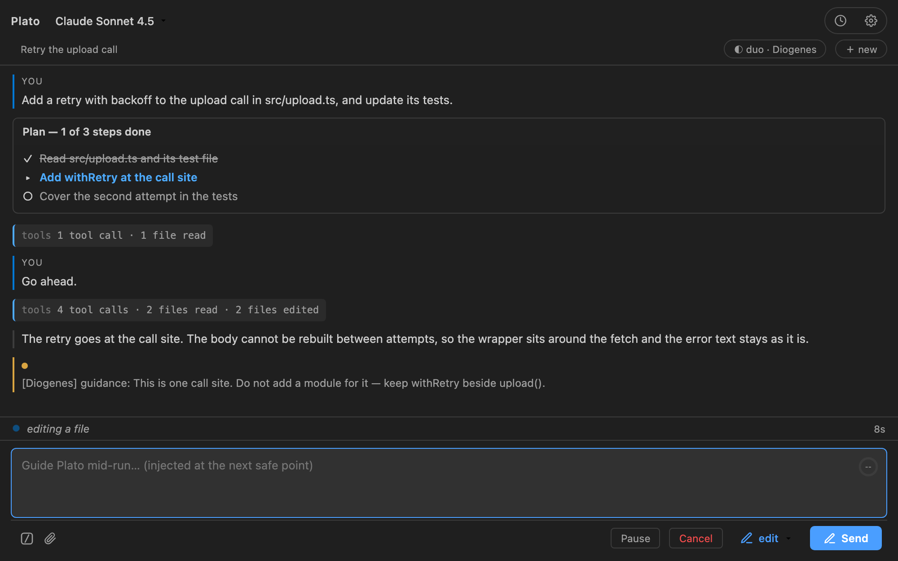
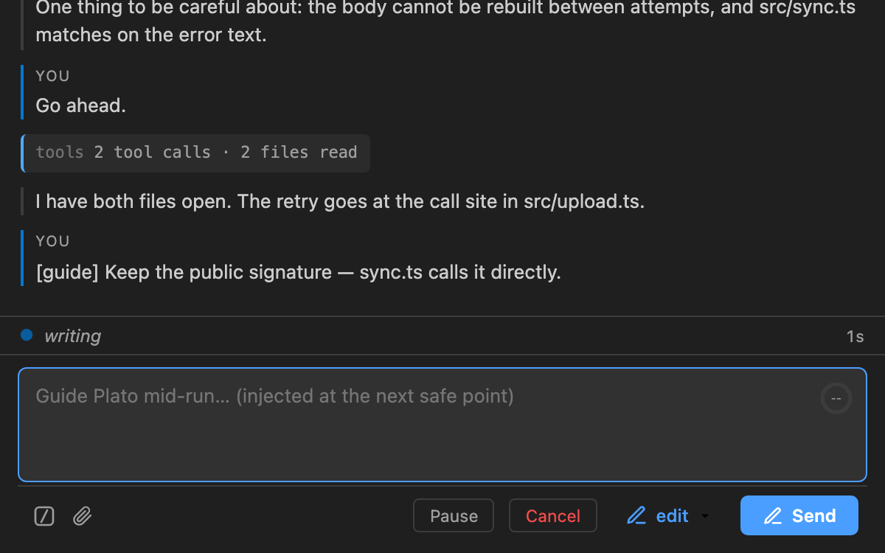
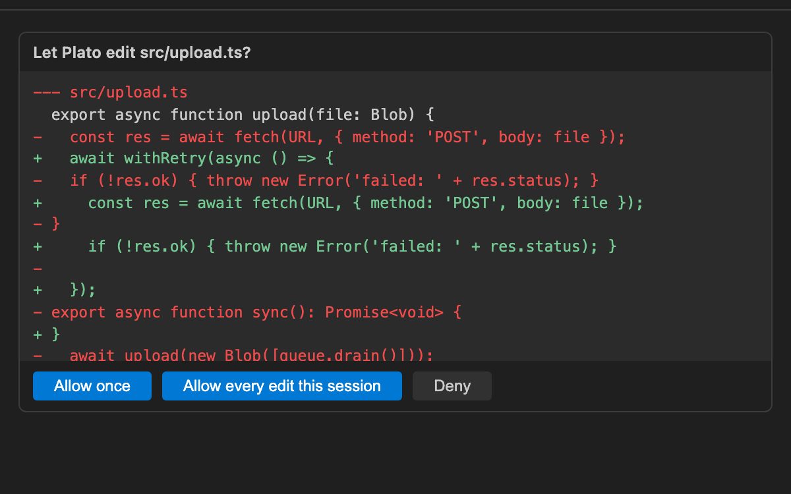

# Plato

Plato is an AI coding agent that works inside your VS Code project. It does not
hide its work: every step appears as it happens — the files it reads, the
commands it runs, the change it proposes — so you can follow the plan as it
forms, take the wheel mid-run, or stop at a safe point.

**Plan, edit, or auto. Solo, duo, or academy. You hold the switch.**

- **Plan** reads and reasons; it changes nothing.
- **Edit** asks before it writes a file or runs a command, and remembers your
  answer for the session.
- **Auto** works without stopping.

Plato cannot change its own mode. When the work needs more room, it asks you.

Plato is pre-release.



*A run in the panel: the task, the tools as they happen, the answer.*



*Type while it works; the direction reaches Plato at the next safe point.*



*Edit mode: the real diff, and one decision before anything changes.*

## Several chats at once

**＋ new** opens another chat. Each chat keeps its own conversation, mode, model
and approvals, and closing one stops only its own run and files it in History.
The sidebar lists what is open, and commands act on the chat you last used.

## Chats can message each other

A chat can send a message to another open chat — by name, or by finding it from
what it is working on. The chat that receives it shows who asked: it starts work
if it is idle, and waits its turn if a run is already going. A chat that was
started by such a message cannot pass one on, so two agents cannot talk in a
loop. In Plan mode, sending asks you first, on a card that names the target and
shows the text.

## Install

Install from the Visual Studio Marketplace:

1. Open the Extensions view in VS Code.
2. Search for **Plato by Applivity**.
3. Choose **Install**.

Or run:

```sh
code --install-extension applivity.plato
```

The listing is at
[Plato by Applivity](https://marketplace.visualstudio.com/items?itemName=applivity.plato).

For a local build, install the VSIX:

```sh
code --install-extension plato-<version>.vsix
```

## Configure a model

Run **Plato: Set API Key** for an Anthropic key. To use another provider, add a
connection in **Settings** (a named Anthropic or OpenAI-compatible endpoint) and
choose the model in the chat header.

You supply the key and pay the model provider.

## What it does

- Shows the agent's work as it runs, and lets you change direction mid-run.
- Pauses at the next safe point. It cannot stop a model call already in flight.
- `plan` is read-only. `edit` asks before writes and shell commands. `auto` runs
  them.
- If a mode blocks the work, Plato can ask to switch. You decide on a card; it
  cannot switch by itself.
- Keeps undo copies of files Plato wrote. A terminal command, or a change you
  made yourself, cannot be undone.
- Reads protected files with their values masked. A value reaches a model only
  through a card you answered.
- Supports Anthropic and any OpenAI-compatible endpoint.
- Runs MCP servers during a run, after a 20-second handshake.
- Saves one transcript per task in `~/.plato/runs/`. Old transcripts are
  compressed after 15 days and can be deleted from History.
- Attaches images to a message.

Prompts go to the model provider you configure. A local model is possible; it is
not the default.

## License

Plato is licensed under the
[Apache License, Version 2.0](https://www.apache.org/licenses/LICENSE-2.0). The
full license text ships with the extension as `LICENSE.txt`, and the
third-party notices ship as `THIRD-PARTY-NOTICES.md`. Both files are inside the
installed extension.

The source is public at
[github.com/Applivity/plato](https://github.com/Applivity/plato) and is licensed
under the Apache License, Version 2.0.

## Support

Questions, bug reports, and feedback: **plato-feedback@applivity.com**.
Privacy policy: [plato.applivity.com/privacy](https://plato.applivity.com/privacy).
